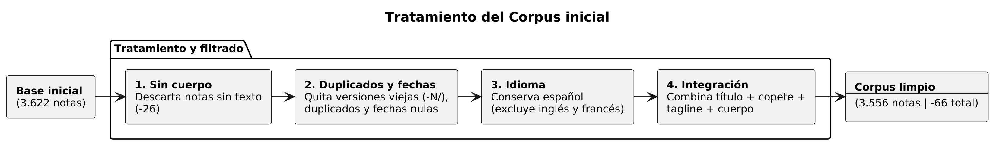
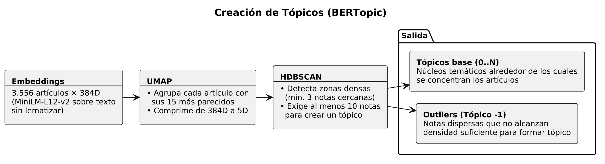

# Informe Final - Proyecto Anfibia

## Introducción al proyecto

Este proyecto nace gracias a la revista Anfibia, que nos proporcionó la base de datos de sus artículos (contaba con título, cuerpo de texto, autores, etc).
La idea principal fue implementar técnicas de Procesamiento de Lenguaje Natural (NLP) para analizar las notas publicadas en su pagina web.

- Analizar que podemos encontrar en los artículos.
Cómo están estructurados, distribuidos, etc

- Evaluar las etiquetas de los artículos.
Cada nota cuenta con una etiqueta puesta manualmente, se evalúa el estado general buscando etiquetas diferentes que implican lo mismo.

- Construir un sistema de recomendación.
En base a un artículo seleccionado encontrar otros de temas similares.

## 1. Objetivos originales planteados

En base a esas ideas y un análisis preliminar del corpus se definieron las siguientes ideas de trabajo concretas.

- Limpiar el Corpus: Crear un conjunto de datos homogéneo y depurado a partir de la base de datos original.
- Crear Tópicos: Descubrir las temáticas/núcleos presentes en los textos y estudiar cómo variaron a lo largo del tiempo.
- Auditar el sistema de etiquetas: Evaluar el etiquetado actual de la revista.
- Desarrollar el recomendador: Implementar un mecanismo para sugerir notas similares en base a la similitud de sus contenidos.

Se entrará en más detalle en la sección de cada una.

## 2. Desarrollo del trabajo

### 2.1. Extracción, limpieza y lematización del corpus

#### 2.1.1. Procesamiento de la base de datos original (`src/extract_posteos_anfibia.py`)
La fuente original de los datos consistio en un volcado SQL completo de la base de datos de WordPress de Revista Anfibia (`.sql`). Era un archivo de gran volumen y contaba con tablas innecesarias propias del sistema ademas de informacion privada de los usuarios (suscriptores, credenciales, registros de plugins y *newsletters*). Por *streaming* se implemento un parser en Python que lee las sentencias `INSERT INTO` línea por línea, filtrando exclusivamente las cinco tablas que decidimos utilizar en el proyecto: `wp_posts`, `wp_postmeta`, `wp_terms`, `wp_term_taxonomy` y `wp_term_relationships`.

Sobre estas tablas ejecutamos cuatro operaciones:

1. **Filtrado:** Se conservaron únicamente los registros con `post_type = "post"` y `post_status = "publish"`. Se dejaron afuera las páginas estáticas (secciones fijas de la página web), borradores y archivos adjuntos porque no son artículos sino elementos propios del sitio o contenido sin publicar. También se excluyeron los tipos `web-story` y `especial`: 
las *web-stories* son contenidos visuales en formato diapositiva, por lo que no nos sera util para el analisis textual, y los *especiales* tienen muy pocos registros como para agruparlos con el archivo general. Quedó una base inicial de **3.622 notas** publicadas entre 2012 y junio de 2026.

1. **Limpieza:** El texto filtrado no esta del todo limpio, quedan en ellos elemenots remanentes de wordpress; etiquetas HTML (`
`, `
`, `<em>`, etc.), bloques de Gutenberg (`<!-- wp:... -->`), *shortcodes* de plugins (`[...]`) y códigos de caracteres especiales (como `&nbsp;` para espacios o `&aacute;` para letras con tilde). Todo esto se limpió tanto en el título (`title_text`), el cuerpo (`body_text`) y el extracto (`excerpt_text`), como en el `copete`, la bajada (`tagline`), la descripción SEO (`yoast_metadesc`) y los nombres de autores e ilustradores, dejando además un único espacio entre palabras.

2. **Reconstrucción y unificación:** Se armó la URL de cada nota a partir de su *slug* (`https://www.revistaanfibia.com/<slug>/`), porque el campo `guid` original a veces apuntaba a entornos de prueba (*staging*). También se juntaron las categorías (`category`), etiquetas (`post_tag`) y géneros (`text_type`) de cada artículo, y pasaron lo IDs de autores e ilustradores (`autor_ids`, `illustrator_ids`, guardados como arrays) a sus nombres en texto.

3. **Chequeo de Privacidad y Consistencia:** Además de ignorar las tablas de usuarios, se buscaron con expresiones regulares todos los correos electrónicos que aparecían dentro de los textos y se reemplazaron por `[EMAIL_REDACTED]`. Al final, se verifica que no se haya colado ninguna nota sin publicar, IDs duplicados, fechas posteriores al volcado, etiquetas HTML sin limpiar ni correos visibles.

](../docs/UML/2.1.1.png)

#### 2.1.2. Exploración y Tratamiento de las variables (`notebooks/01` y `02`)
Una vez teniendo los artículos publicados, se exploraron las variables elegidas y se realizaron otra ronda de operaciones de tratamiento:

- **Artículos sin cuerpo:** Se identificaron **26 artículos** con `body_text` vacío. Al inspeccionar manualmente sus URLs, se verificó que correspondían a otro tipo de publicaciones multimedia (videos, podcasts, etc) o solo contenían un título y un enlace de redirección hacia otra nota, por lo que fueron descartados.

- **Diferentes Versiones:** Cuando se republica o actualiza una nota, WordPress añade un sufijo numérico al *slug* (`-2/`, `-3/`, etc.). Se identificaron las notas que contaban con una versión posterior publicada y se excluyeron los originales reemplazados para evitar duplicación de contenido.

- **Idioma:** Mediante `langdetect` (aplicado sobre los primeros 500 caracteres de `body_text`), se identificaron y excluyeron artículos escritos en inglés y francés. Revisandolos, los artículos clasificados como portugués (`pt`) eran en realidad notas en español con citas o términos que confundían al detector, por lo que se conservaron.

- **Integración:** En los artículos, el **copete** (un anticipo corto de qué trata la nota) y el **`tagline`** (una frase de presentación) consideramos que resumen la idea princial. En un principio pensamos en crear un texto unificado con el título y el cuerpo (`title_text + ". " + body_text`), pero se decidió sumar también estos dos campos (`title_text + copete + tagline + body_text`) cuando están presentes. De esta forma los modelos siguientes contaran con más información.

Y el corpus limpio consta de:

| Campo | Qué es |
| :--- | :--- |
| **`ID`** | Número único que identifica cada nota en la base. |
| **`title_text`** | Título principal de la nota (ya sin código HTML). |
| **`copete`** | Anticipo corto que resume de qué va el artículo antes de arrancar. |
| **`tagline`** | Bajada o frase de presentación que acompaña al título. |
| **`body_text`** | Cuerpo completo de la nota, ya limpio de código HTML y bloques de WordPress. |
| **`post_name` / `source_url`** | Identificador del enlace y dirección pública de la nota (`revistaanfibia.com/<post_name>/`). |
| **`post_date`** | Fecha y hora de publicación de la nota. |
| **`category`** | Categoria del artículo (como *Política y Economía* o *Culturas*). |
| **`post_tag`** | Etiquetas puestas a mano por los editores para marcar temas puntuales. |
| **`text_type`** | Formato o género de la nota (crónica, ensayo, perfil, entrevista, etc.). |
| **`autor_names` / `illustrator_names`** | Nombres de quienes escribieron e ilustraron el artículo. |
| **`lang`** | Idioma detectado del texto en la etapa de filtrado. |
| **`document_text_extended`** | Texto unificado sumando título, copete, bajada (`tagline`) y cuerpo de la nota. |
| **`word_count_extended`** | Cantidad de palabras del texto unificado. |

#### 2.1.3. Lematización y stopwords

Los modelos siguientes (y otras funciones) utilizan el conteo/frecuencia de las palabras de los artículos (como Bag-of-Words y la etapa de representación de tópicos de BERTopic). El texto crudo cuenta con distintas conjugaciones y plurales de sus palabras (por ejemplo, contar por separado *elección* y *elecciones*, o *calle* y *calles*). Por eso, se preparó una versión normalizada del texto (`document_text_final`), SIN eliminar la versión cruda:

- **Lematización:** Se procesaron los artículos con el modelo en español `es_core_news_md`. Se conservaron únicamente palabras alfabéticas en minúscula llevadas a su lema base. Tambien se agrego manualmente una regla manual para unificar `países` y `paises` en `país`, ya que el modelo los devolvia como lemas distintos. 
Finalmente el vocabulario resultante paso de **~67000** a **~43000** terminos.

- **Stopwords:** Las *stopwords* son palabras (muy frecuentes) que se filtran antes de analizar el texto porque molestaban en los analisis de frecuencia que realizamos. Como preposiciones y conectores (*el*, *de*, *que*, *para*). Al revisar las palabras más repetidas, aparecieron muchos términos que salen en casi todas las notas sin importar el tema —como *anfibia*, *revista*, *crónica*, *argentina*, *país*, *político*, *tiempo*, *vida* o *persona*—. Por eso se armó un diccionario propio sumando estas palabras frecuentes. 

*Esto se expandio cuando se analizaron las palabras clave de los tópicos (se explicara en detalle, en la sección de los tópicos)*

- **Algunos Resultados:**

Al comparar las 10 palabras más frecuentes antes y después de lematizar, se ve cómo la lematización juntó variantes que antes quedaban repartidas (por ejemplo, *social* y *sociales* se unificaron en un solo término, y *mujeres* pasó a sumarse en *mujer* con 10.692).

**Sin lematizar**

| Palabra | Artículos | Frecuencia total |
| :--- | :---: | :---: |
| *puede* | 2.761 | 9.296 |
| *gobierno* | 1.755 | 8.274 |
| *mundo* | 2.451 | 8.239 |
| *pais* | 2.205 | 7.423 |
| *mujeres* | 1.445 | 7.370 |
| *trabajo* | 2.157 | 7.205 |
| *personas* | 2.173 | 6.837 |
| *social* | 2.069 | 6.805 |
| *casa* | 1.850 | 6.767 |
| *sociales* | 1.944 | 5.719 |
| ... | ... | ... |

**Lematizado**

| Palabra | Artículos | Frecuencia total |
| :--- | :---: | :---: |
| *politico* | 2.269 | 12.372 |
| *social* | 2.536 | 12.229 |
| *mujer* | 1.884 | 10.692 |
| *pais* | 2.417 | 9.843 |
| *politica* | 2.138 | 9.611 |
| *gobierno* | 1.859 | 9.327 |
| *publico* | 2.386 | 8.656 |
| *mundo* | 2.477 | 8.512 |
| *casa* | 2.009 | 7.963 |
| *trabajo* | 2.182 | 7.376 |
| ... | ... | ... |

Se muestra la comparación de la nube de palabras (tamaño decidido por frecuencia) para la categoría **Política y Economía** antes y después de lematizar:

**Sin lematizar**

**Lematizado**

En la comparación se nota cómo en la versión lematizada se unificaron las diferentes versiones en un lema y la falta de las palabras conectoras que se quitaron con las *stopwords*.

### 2.2. Modelado de tópicos

El objetivo de crear tópicos es descubrir los núcleos temáticos reales alrededor de los cuales se concentran los artículos, sin depender de las categorías fijas ni de las etiquetas puestas a mano. Contar con estos núcleos permite ver cómo evolucionó Anfibia a lo largo de los años y como una base sobre la cual crear un recomendador por Tópicos similares.

#### 2.2.1. Tópicos con BerTopic

Antes de llegar a este modelo, se probaron otros enfoques basados únicamente en conteo de palabras (como LDA) y modelos de *embeddings* en español. El problema de usar solo el conteo de palabras es que dos artículos sobre el mismo tema pueden usar vocabularios muy distintos —algo muy común en crónicas y ensayos literarios—, por lo que se descartó LDA. Por otro lado, si se usan únicamente *embeddings* (agrupando notas), se consiguen tópicos coherentes pero el modelo no devuelve por sí solo una manera de explicar de qué trata cada uno.

Por eso se recurrió a **BERTopic**, que ademas de la creación de topicos nos proporciona la extracción de palabras clave y otras funcionalidades. En esta primera etapa, para detectar los Tópicos se calcularon *embeddings* densos sobre el texto original sin lematizar (`document_text_original`) usando el modelo `paraphrase-multilingual-MiniLM-L12-v2`, de manera que tiene en cuenta la estructura de las oraciones y el contexto de las palabras en ellas, algo que se pierde con la lematización. Como cada artículo queda representado en un espacio de 384 dimensiones (sus embeddings), primero se comprimieron esos vectores con `UMAP` conservando tanto la cercanía entre notas parecidas y la estructura general.

Sobre ese espacio reducido se aplicó el algoritmo de agrupamiento por densidad `HDBSCAN` (`min_cluster_size=10`, `min_samples=3`). A diferencia de otros metodos que exigen fijar de antemano cuántos tópicos existen y obligan a meter cada artículo en algún núcleo aunque no encaje—, `HDBSCAN` busca zonas donde se acumula una alta densidad de artículos similares entre sí, permitiendo que cada tópico decida sus artículos. Además, deja un tópico aparte (`-1`) todas las notas demasiado específicas que no caen claramente dentro de ningun otro, esto ademas ayuda a la creacion de palabras clave.

Con esos parametros se busco que el modelo busque Tópicos muy definidos aunque no lleguen a tener un gran numero de notas. 

*Cada artículo posee una distribucion de los tópicos, osea, un porcentaje de que tanto de cada tópico posee. Decimos que un artículo pertenece a cierto Tópico cuando ese es el que mayor porcentaje tiene.*

#### 2.2.2. Palabras clave de cada tópico

**Creación**

Una vez formados los Tópicos (que solamente estan numerados), el siguiente paso fue ponerles un nombre descriptivo que exprese las notas que representan ese Tópico. Per se opto por no depender de un nombre manual y arriesgar no expresar de manera correcta el Tópico (aun leyendo cada artículo podrian haber errores o sesgos). 

Aca entra en juego otra funcionalidad de BERTopic, la de buscar las palabras claves de cada Tópico. Se usara de manera que el nombre de cada uno este dado por sus propias palabras clave.
Para calcular qué términos definen mejor a cada núcleo, primero BERTopic concatena todos los artículos asignados a un mismo tópico como si fueran un único gran documento y aplica **c-TF-IDF** (*Class-based TF-IDF*). Mientras que el TF-IDF clásico mide qué tan importante es una palabra dentro de un artículo frente a todos los demas, el `c-TF-IDF` mide qué tan característica es una palabra dentro de un tópico frente al resto. Así, palabras generales en los tópicos pierden peso y suben las que distinguen específicamente a esa tópico.

Sin embargo, quedarse únicamente con los puntajes más altos de `c-TF-IDF` todavía tiene un punto débil: a veces premia términos demasiado puntuales que se repitieron mucho en una o dos crónicas muy largas del núcleo, pero que no representan al resto de los artículos del grupo. Para resolver esto se encadenó **`KeyBERTInspired`**, un paso de reordenamiento semántico que toma las mejores palabras candidatas de `c-TF-IDF`, calcula sus *embeddings* y mide qué tan cerca están del vector promedio (centroide) de todo el núcleo. De esta manera, las palabras clave finales no solo son frecuentes dentro de ese núcleo y raras en los demás, sino que reflejan el sentido global de todos los artículos que lo integran.

](../docs/UML/2.2.2.png)

En el ejemplo, dividir la cantidad de veces que aparece cada palabra por el total de palabras del tópico ($\Vert{}tf_{x,c}\Vert{}$) sirve para trabajar con proporciones y compensar que un tópico tenga muchas más notas que otro. Por su parte, el logaritmo baja el puntaje de las palabras que aparecen repetidas por todo el archivo ($f_x$) frente al promedio de palabras por tópico ($A$). En el diagrama se ve bien qué pasa con la palabra en rojo (*crisis*): como aparece en notas de ambos tópicos (`N1` a `N4`), en el conteo suma **2** apariciones tanto en `T0` como en `T1`, empatando con las palabras propias de cada uno (*votar* en `T0` y *aborto* en `T1`). Pero al aplicar `c-TF-IDF`, como *crisis* está en ambos ($f_x = 4$), el cálculo la penaliza y su puntaje cae a **`0.31`** en los dos tópicos, mientras que las palabras que sí son exclusivas de cada tema quedan arriba con **`0.46`** y **`0.32`**. De esta manera, *crisis* queda afuera y los nombres se arman solo con los términos que realmente distinguen a cada tópico (`votar_deuda_ley` para `T0` y `aborto_mujer_marcha` para `T1`).

**Uso en la iteración de Stopwords**

Además, al revisar las primeras listas de palabras clave de cada tópico (en esta etapa todavía no habíamos armado nubes de palabras por tópico, sino que los inspeccionábamos directamente mediante gráficos de barras con los puntajes de relevancia), saltó un problema: aparecían términos con gran peso en varios núcleos a la vez, lo cual, aunque tuvieran mayor puntaje `c-TF-IDF`, no servía para entender de qué trataba cada uno.

Para corregir esto se hizo un proceso iterativo: se revisaban los rankings de palabras de cada tópico, se anotaban los términos relevantes pero que abarcaban varios tópicos y se los agregaba en tandas sucesivas a las stopwords, cuidando de dejar afuera palabras que sí representen individualidad de los Tópicos.

La comparación de los 6 tópicos con mayor volumen del modelo antes y después de ampliar las Stopwords muestra cómo este filtrado aclara que significa cada Tópico:

| Tópico | Palabras clave antes (Stopwords generales) | Palabras clave después (agregando Stopwords) |
| :--- | :--- | :--- |
| **Tópico 00** | *político, política, candidato, electoral, campaña, votar* | *candidato, electoral, campaña, debate, votar, discurso* |
| **Tópico 01** | *autor, escritor, literatura, novela, personaje, libro* | *literario, autor, escritor, poeta, protagonista, literatura* |
| **Tópico 02** | *feminismo, feminista, aborto, político, política, debate* | *feminismo, feminista, aborto, abortar, patriarcado, debate* |
| **Tópico 03** | *historia, vivir, hombre, vida, muerte, contar* | *muerto, dictadura, muerte, morir, desaparición, cuba* |
| **Tópico 04** | *político, política, cambio, decir, además, seguir* | *ambiental, ambiente, crisis, proyecto, sociedad, futuro* |
| **Tópico 05** | *economía, crisis, pobreza, económico, reforma, inflación* | *déficit, economía, pobreza, económico, fiscal, deuda* |

En los Tópicos **03** y **04** aclaró de que trataban.

*Esta ultima tabla se realizo utilizando nuestro ultimo modelo, por lo que no son exactamente los mismos tópicos con los que contabamos al realizar la iteración de las stopwords*

#### 2.2.3. Reducción y fusión iterativa de tópicos

Al crear los Tópicos, se dejo que el modelo tuviera libertad de crear una gran cantidad de ellos para tener una gran granularidad, que cada Tópico tenga un significado individual. Sin embargo el numero fue demasiado grande (más de 70 Tópicos), lo cual dificultaba los análisis realizados con ellos.
 Si se utiliza la reducción automática propia de BERTopic , el algoritmo fusiona tópicos según umbrales internos y suele mezclar Tópicos que en realidad se pueden interpretar como diferentes (ej: uno que habla de elecciones y otro que habla de la economia, ambos contienen palabras clave similares y por ello los une, aunque en realidad son diferentes). Se optó por dejar que el modelo siguiera detectando todos los núcleos iniciales sin límite, luego combinarlos automaticamente hasta 40 Tópicos. Por ultimo, evaluar esos 41 y decidir cuales unir de manera manual.

Para decidir qué tópicos unir se utilizó **`visualize_hierarchy`**, una herramienta de BERTopic que aplica **clustering jerárquico aglomerativo** entre las representaciones `c-TF-IDF` de cada tópico. El resultado es un dendrograma donde la longitud de cada rama indica qué tan distintos son dos tópicos en términos sus palabras: las ramas que se unen más cerca de la base (menor distancia) son las que BERTOPIC considera candidatas a unirse.

Entonces, se itero siguiendo dos verificaciones antes de aplicar **`merge_topics()`** (función que unifica los documentos de los tópicos seleccionados y vuelve a computar sus pesos `c-TF-IDF` y el reordenamiento con `KeyBERTInspired`):

1. **Lectura del dendrograma:** Identificación de pares de Tópicos de ramas con menor distancia del coseno entre sus vectores `c-TF-IDF`.

2. **Inspección de palabras clave:** Verificación de que los términos principales de ambos tópicos realmente tienen una tematica similar y no a fenómenos distintos que utilizan palabras similares.

Finalmente se realizaron 4 iteraciones:

| Etapa | Cantidad de tópicos |
| --- | --- |
| **Modelo Inicial** | 79 |
| **1.ª fusión (automática)** | **40** |
| **2.ª fusión** | **30** |
| **3.ª fusión** | **27** |
| **4.ª fusión (final)** | **22** |

El proceso se detuvo en la 4ta fusión, al inspeccionar el dendrograma, las siguientes uniones implicaban distancias del coseno demasiado elevadas. Continuar habria unido Tópicos conceptualmente distantes, perdiendo la especificidad alcanzada.

En los pares con menor distancia del coseno, la cercanía responde a vocabulario similares pero cada Tópico mantiene una identidad propia que se perdería si se consolidaran.
Por ejemplo, aunque los tópicos **04** y **05** aparecen próximos, al revisar los títulos y taglines de sus artículos se comprueba que abordan fenómenos diferenciados:

* **Tópico 04 (`4_ambiental_ambiente_crisis`):** Temas territoriales, productivas y socioambientales.
  * *"La reforma agraria de las mujeres guaraníes"*
  * *"Epecuén jamás se inundaría"* — *Tagline: Adelanto*
  * *"Copiapó: si la luz fuera líquida"* — *Tagline: Adelanto*
* **Tópico 05 (`5_déficit_economía_pobreza`):** Análisis financieros, cambiarios y macroeconómicos.
  * *"Todo sobre los buitres"* — *Tagline: Deuda externa*
  * *"DÓLAR BLUE: LA CORRIDA QUE NO FUE"* — *Tagline: Mercados*
  * *"Syriza: golpear y negociar"* — *Tagline: Crisis europea*

#### 2.2.4. Tratamiento de *outliers* (`Tópico -1`)

Una proporción importante de los artículos quedo inicialmente sin asignación temática bajo la etiqueta `-1` (*outliers*).
Se evaluaron dos estrategias para integrar parte de estos documentos sin degradar la calidad de los 22 tópicos consolidados:

1. **Reasignación forzada :** Asigna el 100 % de los `-1` al tópico con el centroide más cercano. Si bien elimina por completo los *outliers*, diluye las palabras clave (`c-TF-IDF`) y reduciendo la coherencia de los Tópicos.
2. **Reasignación acotada por umbral de similitud coseno ($\ge 0,65$):** Se calculó el centroide semántico de cada uno de los 22 tópicos promediando los *embeddings* naturales (texto sin lematizar) de sus artículos. Luego se midió la similitud del coseno entre cada documento `-1` y los 22 centroides, reasignando únicamente aquellas notas cuya similitud máxima alcanzara o superara `0,65`, y por ultimo se recalibraron los pesos c-TF-IDF.

Se decidio optar por la segunda opción. Lo cual redujo los Outliers:

Con ello, los Tópicos finales son:

| Tópico | Palabras clave principales | Artículos (base) | Artículos (umbral $\ge 0,65$) | Variación |
| :--- | :--- | :---: | :---: | :---: |
| **00** | *candidato, electoral, campaña, debate, votar, discurso* | 456 | 620 | +164 |
| **01** | *literario, autor, escritor, poeta, protagonista, literatura* | 304 | 392 | +88 |
| **02** | *feminismo, feminista, aborto, abortar, patriarcado, debate* | 288 | 334 | +46 |
| **03** | *muerto, dictadura, muerte, morir, desaparición, cuba* | 164 | 247 | +83 |
| **04** | *ambiental, ambiente, crisis, proyecto, sociedad, futuro* | 144 | 198 | +54 |
| **05** | *déficit, economía, pobreza, económico, fiscal, deuda* | 139 | 195 | +56 |
| **06** | *futbolista, fifa, fútbol, brasil, barcelona, deporte* | 129 | 141 | +12 |
| **07** | *pedagógico, enseñanza, escolar, educativo, enseñar, educación* | 115 | 126 | +11 |
| **08** | *epidemia, pandemia, vacunar, virus, vacuna, vacunación* | 98 | 126 | +28 |
| **09** | *periodístico, mediático, periodista, noticia, publicar, democracia* | 76 | 119 | +43 |
| **10** | *tecnológico, innovación, tecnología, inteligencia, futuro, inteligente* | 60 | 82 | +22 |
| **11** | *justicia, judicial, juzgado, tribunal, juez, condena* | 48 | 81 | +33 |
| **12** | *soviético, rusia, siria, ucrania, moscú, guerra* | 69 | 73 | +4 |
| **13** | *música, musical, músico, canción, cantante, cantar* | 54 | 71 | +17 |
| **14** | *papal, catolicismo, arzobispo, católica, católico, vaticano* | 58 | 64 | +6 |
| **15** | *urbano, ciudad, vecino, pueblo, barrio, público* | 23 | 47 | +24 |
| **16** | *astrónomo, universo, astrología, ciencia, científico, teoría* | 19 | 25 | +6 |
| **17** | *selva, ecológico, naturaleza, paisaje, extinción, existencia* | 12 | 22 | +10 |
| **18** | *presidencial, trump, republicano, bush, presidencia, presidente* | 14 | 20 | +6 |
| **19** | *submarino, marino, océano, naval, marítimo, embarcación* | 15 | 15 | +0 |
| **20** | *asesino, asesinar, héroe, superhéroe, asesinato, matar* | 10 | 12 | +2 |
| **21** | *papá, padre, abuelo, hermano, hombre, mamá* | 12 | 12 | +0 |

Finalmente, se inspeccionaron los artículos que permanecieron por debajo del umbral `0,65`. Se decidió preservarlos e intentar agregarlos al análisis de Tópicos. Para ello se los integro como un Tópico (**Tópico 100**).

| Tópico | Palabras clave principales | Artículos|
| :--- | :--- | :---: |
| **100** | *padre, hombre, pueblo, causa, humano, género* | 534 |

#### 2.3. Exploración de los Tópicos

Una vez consolidados los 22 tópicos temáticos y el Tópico 100, se analizaron los resultados desde tres perspectivas: la distribución espacial de los artículos, su evolución temporal y como afecta a la autoria.

##### 2.3.1. Proyección bidimensional del espacio semántico

Para visualizar cómo se agrupan y se relacionan los **3.556** artículos segun sus Tópicos, se proyectaron sus embeddings (texto sin lematizar) de 384 dimensiones a un plano 2D mediante `UMAP` (`n_neighbors=15`, `min_dist=0.0`, métrica del coseno y `random_state=42`). Sobre cada Tópico se identificó además su **artículo más representativo** (el documento con mayor similitud del coseno respecto al centroide del tópico).

La proyección permite observar tres comportamientos:

* **Tópicos bien separados:** Los tópicos con vocabularios forman grupos compactos y claramente diferenciados del resto. Lo que no significa que no esten cerca y en ciertos momentos se cruzen con otros.
* **Tópicos proximos:** Los tópicos de temas similares como política electoral (**00**), economía (**05**), justicia (**11**) y medios (**09**)— aparecen contiguos en el plano, reflejando el cruce o como un artículo no esta limitado a un solo Tópico.
* **Tópico 100:** Los 534 artículos outliers no forman un grupo separado, sino que se distribuyen entre distintos tópicos, lo cual tiene sentido pues son los que no tenian cercania suficiente para pertenecer a un Tópico.

##### 2.3.2. Evolución temporal y picos

Para estudiar cómo cambiaron los temas de la revista a lo largo del tiempo, se aplicó `topics_over_time` (otra funcion de BERTopic) dividiendo el período 2012–2026 en **40 ventanas temporales**.

Ademas se buscaron los **picos locales y máximos históricos** (ventanas donde la cantidad de publicaciones supera a las ventanas vecinas y al promedio histórico del tópico), asociando cada pico con sus tres artículos más cercanos al centroide semántico de ese período.

El gráfico compara la evolución de dos tópicos con comportamientos bien marcados:

**Tópico 02 (`feminismo_feminista_aborto`):** Presenta actividad sostenida desde 2015 y alcanza su pico máximo en mayo de 2018, en coincidencia con el debate por la IVE, manteniendo luego una presencia regular.

**Tópico 08 (`epidemia_pandemia_vacunar`):** Se mantiene en valores mínimos hasta 2019 y registra un pico en **febrero de 2020** (**41** artículos), concentrando su volumen durante la pandemia de COVID-19 para luego descender de forma gradual.

| Tópico | Pico máximo | Frecuencia | Artículo representativo | Tagline |
| :--- | :---: | :---: | :--- | :--- |
| **02** *(feminismo_feminista_aborto)* | 2018-05 | 43 | *Aborto es lengua popular* | Después del 8A |
| **08** *(epidemia_pandemia_vacunar)* | 2020-02 | 41 | *Sabía que ibas a reaccionar así* | Cómo nos comportamos ante la flexibilización |

##### 2.3.3. Análisis de autores por tópico

Para ver qué escribe cada autor, se separaron los nombres de la columna `autor_names` (para contar por separado a cada autor cuando una nota fue escrita entre dos o más personas) y se cruzó cada autor con el tópico de sus artículos. Con eso se calculó cuántas notas tiene cada uno en cada tópico y qué porcentaje representa sobre el total de notas que escribió en Anfibia.

Al revisar los datos aparecen tanto autores que suelen escribir sobre un mismo tópico —como **Juan Pablo Bohoslavsky** o **Esteban De Gori**— como otros cuyas publicaciones se reparten entre varios tópicos.

| Tópico | Autor destacado | Notas en el tópico | Total de notas del autor | % en el tópico |
| :--- | :--- | :---: | :---: | :---: |
| **00** (`candidato_electoral_campaña`) | Esteban De Gori | 22 | 27 | 81,5 % |
| **01** (`literario_autor_escritor`) | Julieta Greco | 12 | 23 | 52,2 % |
| **02** (`feminismo_feminista_aborto`) | Luciana Peker | 10 | 13 | 76,9 % |
| **05** (`déficit_economía_pobreza`) | Juan Pablo Bohoslavsky | 8 | 9 | 88,9 % |
| **06** (`futbolista_fifa_fútbol`) | Alejandro Wall | 11 | 16 | 68,8 % |