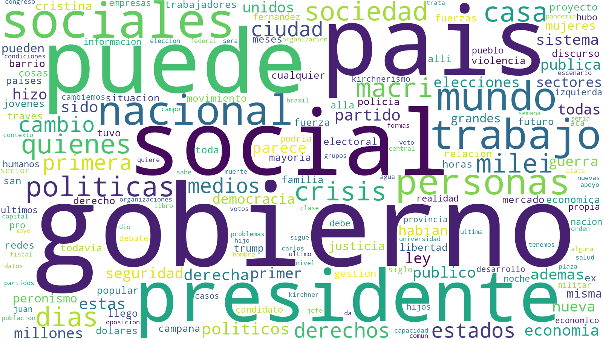

# Informe Final - Proyecto Anfibia

## Introducción al proyecto

Este proyecto nace gracias a la revista Anfibia, que nos proporcionó la base de datos de sus artículos (contaba con título, cuerpo de texto, autores, etc).
La idea principal fue implementar técnicas de Procesamiento de Lenguaje Natural (NLP) para analizar las notas publicadas en su pagina web.

- Analizar que podemos encontrar en los artículos.
Cómo están estructurados, distribuidos, etc

- Evaluar las etiquetas de los artículos.
Cada nota cuenta con una etiqueta puesta manualmente, se evalúa el estado general buscando etiquetas diferentes que implican lo mismo.

- Construir un sistema de recomendación.
En base a un artículo seleccionado encontrar otros de temas similares.

## 1. Objetivos originales planteados

En base a esas ideas y un análisis preliminar del corpus se definieron las siguientes ideas de trabajo concretas.

- Limpiar el Corpus: Crear un conjunto de datos homogéneo y depurado a partir de la base de datos original.
- Crear Tópicos: Descubrir las temáticas/núcleos presentes en los textos y estudiar cómo variaron a lo largo del tiempo.
- Auditar el sistema de etiquetas: Evaluar el etiquetado actual de la revista.
- Desarrollar el recomendador: Implementar un mecanismo para sugerir notas similares en base a la similitud de sus contenidos.

Se entrará en más detalle en la sección de cada una.

## 2. Desarrollo del trabajo

### 2.1. Extracción, limpieza y lematización del corpus

#### 2.1.1. Procesamiento de la base de datos original (`src/extract_posteos_anfibia.py`)
La fuente original de los datos consistio en un volcado SQL completo de la base de datos de WordPress de Revista Anfibia (`.sql`). Era un archivo de gran volumen y contaba con tablas innecesarias propias del sistema ademas de informacion privada de los usuarios (suscriptores, credenciales, registros de plugins y *newsletters*). Por *streaming* se implemento un parser en Python que lee las sentencias `INSERT INTO` línea por línea, filtrando exclusivamente las cinco tablas que decidimos utilizar en el proyecto: `wp_posts`, `wp_postmeta`, `wp_terms`, `wp_term_taxonomy` y `wp_term_relationships`.

Sobre estas tablas ejecutamos cuatro operaciones:

1. **Filtrado:** Se conservaron únicamente los registros con `post_type = "post"` y `post_status = "publish"`. Se dejaron afuera las páginas estáticas (secciones fijas de la página web), borradores y archivos adjuntos porque no son artículos sino elementos propios del sitio o contenido sin publicar. También se excluyeron los tipos `web-story` y `especial`: 
las *web-stories* son contenidos visuales en formato diapositiva, por lo que no nos sera util para el analisis textual, y los *especiales* tienen muy pocos registros como para agruparlos con el archivo general. Quedó una base inicial de **3.622 notas** publicadas entre 2012 y junio de 2026.

1. **Limpieza:** El texto filtrado no esta del todo limpio, quedan en ellos elemenots remanentes de wordpress; etiquetas HTML (`
`, `
`, `<em>`, etc.), bloques de Gutenberg (`<!-- wp:... -->`), *shortcodes* de plugins (`[...]`) y códigos de caracteres especiales (como `&nbsp;` para espacios o `&aacute;` para letras con tilde). Todo esto se limpió tanto en el título (`title_text`), el cuerpo (`body_text`) y el extracto (`excerpt_text`), como en el `copete`, la bajada (`tagline`), la descripción SEO (`yoast_metadesc`) y los nombres de autores e ilustradores, dejando además un único espacio entre palabras.

2. **Reconstrucción y unificación:** Se armó la URL de cada nota a partir de su *slug* (`https://www.revistaanfibia.com/<slug>/`), porque el campo `guid` original a veces apuntaba a entornos de prueba (*staging*). También se juntaron las categorías (`category`), etiquetas (`post_tag`) y géneros (`text_type`) de cada artículo, y pasaron lo IDs de autores e ilustradores (`autor_ids`, `illustrator_ids`, guardados como arrays) a sus nombres en texto.

3. **Chequeo de Privacidad y Consistencia:** Además de ignorar las tablas de usuarios, se buscaron con expresiones regulares todos los correos electrónicos que aparecían dentro de los textos y se reemplazaron por `[EMAIL_REDACTED]`. Al final, se verifica que no se haya colado ninguna nota sin publicar, IDs duplicados, fechas posteriores al volcado, etiquetas HTML sin limpiar ni correos visibles.

](../docs/UML/2.1.1.png)

#### 2.1.2. Exploración y Tratamiento de las variables (`notebooks/01` y `02`)
Una vez teniendo los artículos publicados, se exploraron las variables elegidas y se realizaron otra ronda de operaciones de tratamiento:

- **Artículos sin cuerpo:** Se identificaron **26 artículos** con `body_text` vacío. Al inspeccionar manualmente sus URLs, se verificó que correspondían a otro tipo de publicaciones multimedia (videos, podcasts, etc) o solo contenían un título y un enlace de redirección hacia otra nota, por lo que fueron descartados.

- **Diferentes Versiones:** Cuando se republica o actualiza una nota, WordPress añade un sufijo numérico al *slug* (`-2/`, `-3/`, etc.). Se identificaron las notas que contaban con una versión posterior publicada y se excluyeron los originales reemplazados para evitar duplicación de contenido.

- **Idioma:** Mediante `langdetect` (aplicado sobre los primeros 500 caracteres de `body_text`), se identificaron y excluyeron artículos escritos en inglés y francés. Revisandolos, los artículos clasificados como portugués (`pt`) eran en realidad notas en español con citas o términos que confundían al detector, por lo que se conservaron.

- **Integración:** En los artículos, el **copete** (un anticipo corto de qué trata la nota) y el **`tagline`** (una frase de presentación) consideramos que resumen la idea princial. En un principio pensamos en crear un texto unificado con el título y el cuerpo (`title_text + ". " + body_text`), pero se decidió sumar también estos dos campos (`title_text + copete + tagline + body_text`) cuando están presentes. De esta forma los modelos siguientes contaran con más información.

Y el corpus limpio consta de:

| Campo | Qué es |
| :--- | :--- |
| **`ID`** | Número único que identifica cada nota en la base. |
| **`title_text`** | Título principal de la nota (ya sin código HTML). |
| **`copete`** | Anticipo corto que resume de qué va el artículo antes de arrancar. |
| **`tagline`** | Bajada o frase de presentación que acompaña al título. |
| **`body_text`** | Cuerpo completo de la nota, ya limpio de código HTML y bloques de WordPress. |
| **`post_name` / `source_url`** | Identificador del enlace y dirección pública de la nota (`revistaanfibia.com/<post_name>/`). |
| **`post_date`** | Fecha y hora de publicación de la nota. |
| **`category`** | Categoria del artículo (como *Política y Economía* o *Culturas*). |
| **`post_tag`** | Etiquetas puestas a mano por los editores para marcar temas puntuales. |
| **`text_type`** | Formato o género de la nota (crónica, ensayo, perfil, entrevista, etc.). |
| **`autor_names` / `illustrator_names`** | Nombres de quienes escribieron e ilustraron el artículo. |
| **`lang`** | Idioma detectado del texto en la etapa de filtrado. |
| **`document_text_extended`** | Texto unificado sumando título, copete, bajada (`tagline`) y cuerpo de la nota. |
| **`word_count_extended`** | Cantidad de palabras del texto unificado. |

#### 2.1.3. Lematización y stopwords

Los modelos siguientes (y otras funciones) utilizan el conteo/frecuencia de las palabras de los artículos (como Bag-of-Words y la etapa de representación de tópicos de BERTopic). El texto crudo cuenta con distintas conjugaciones y plurales de sus palabras (por ejemplo, contar por separado *elección* y *elecciones*, o *calle* y *calles*). Por eso, se preparó una versión normalizada del texto (`document_text_final`), SIN eliminar la versión cruda:

- **Lematización:** Se procesaron los artículos con el modelo en español `es_core_news_md`. Se conservaron únicamente palabras alfabéticas en minúscula llevadas a su lema base. Tambien se agrego manualmente una regla manual para unificar `países` y `paises` en `país`, ya que el modelo los devolvia como lemas distintos. 
Finalmente el vocabulario resultante paso de **~67000** a **~43000** terminos.

- **Stopwords:** Las *stopwords* son palabras (muy frecuentes) que se filtran antes de analizar el texto porque molestaban en los analisis de frecuencia que realizamos. Como preposiciones y conectores (*el*, *de*, *que*, *para*). Al revisar las palabras más repetidas, aparecieron muchos términos que salen en casi todas las notas sin importar el tema —como *anfibia*, *revista*, *crónica*, *argentina*, *país*, *político*, *tiempo*, *vida* o *persona*—. Por eso se armó un diccionario propio sumando estas palabras frecuentes. 

*Esto se expandio cuando se analizaron las palabras clave de los tópicos (se explicara en detalle, en la sección de los tópicos)*

- **Algunos Resultados:**

Al comparar las 10 palabras más frecuentes antes y después de lematizar, se ve cómo la lematización juntó variantes que antes quedaban repartidas (por ejemplo, *social* y *sociales* se unificaron en un solo término, y *mujeres* pasó a sumarse en *mujer* con 10.692).

**Sin lematizar**

| Palabra | Artículos | Frecuencia total |
| :--- | :---: | :---: |
| *puede* | 2.761 | 9.296 |
| *gobierno* | 1.755 | 8.274 |
| *mundo* | 2.451 | 8.239 |
| *pais* | 2.205 | 7.423 |
| *mujeres* | 1.445 | 7.370 |
| *trabajo* | 2.157 | 7.205 |
| *personas* | 2.173 | 6.837 |
| *social* | 2.069 | 6.805 |
| *casa* | 1.850 | 6.767 |
| *sociales* | 1.944 | 5.719 |
| ... | ... | ... |

**Lematizado**

| Palabra | Artículos | Frecuencia total |
| :--- | :---: | :---: |
| *politico* | 2.269 | 12.372 |
| *social* | 2.536 | 12.229 |
| *mujer* | 1.884 | 10.692 |
| *pais* | 2.417 | 9.843 |
| *politica* | 2.138 | 9.611 |
| *gobierno* | 1.859 | 9.327 |
| *publico* | 2.386 | 8.656 |
| *mundo* | 2.477 | 8.512 |
| *casa* | 2.009 | 7.963 |
| *trabajo* | 2.182 | 7.376 |
| ... | ... | ... |

Se muestra la comparación de la nube de palabras (tamaño decidido por frecuencia) para la categoría **Política y Economía** antes y después de lematizar:

**Sin lematizar**

**Lematizado**

En la comparación se nota cómo en la versión lematizada se unificaron las diferentes versiones en un lema y la falta de las palabras conectoras que se quitaron con las *stopwords*.

