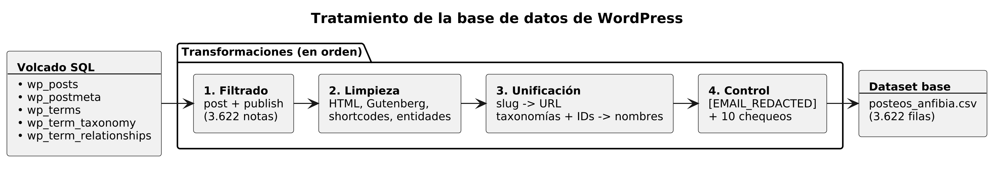
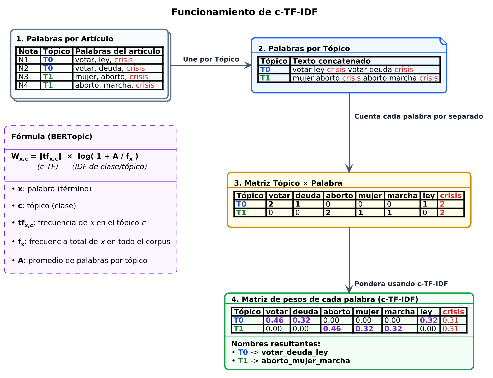
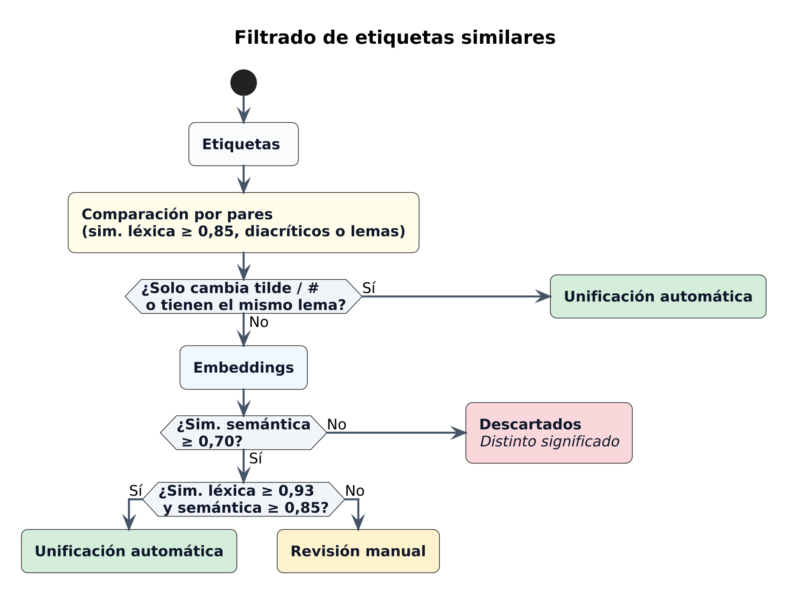
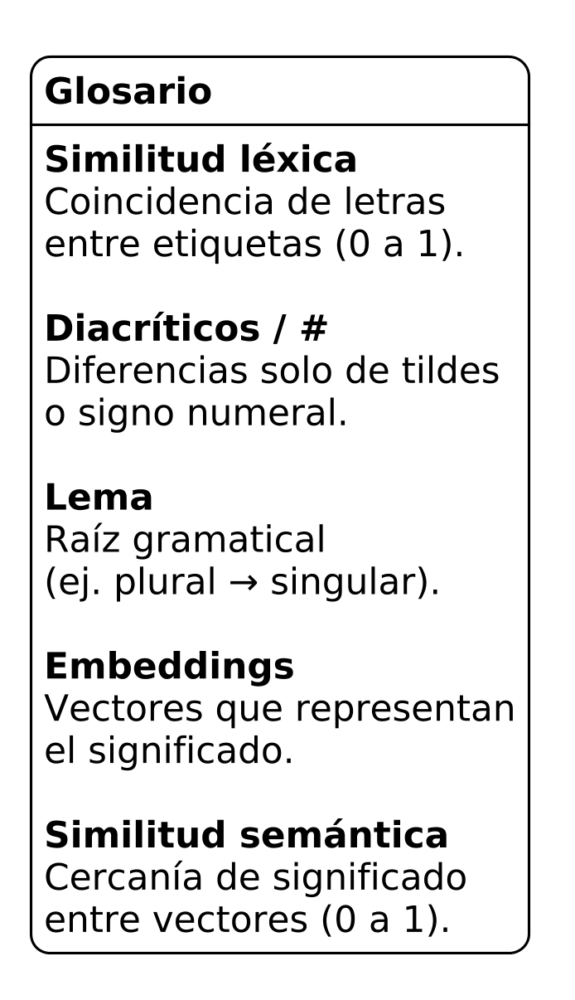
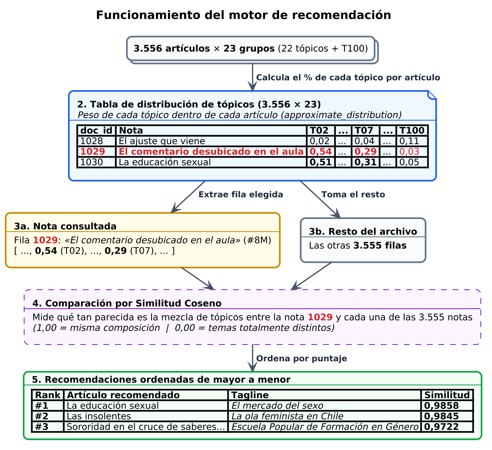

# Informe Final - Proyecto Anfibia

## Introducción al proyecto

Este proyecto surge a partir de una colaboración entre el Centro de Inteligencia Artificial Interdisciplinario (CIAI) de la UNSAM y [*Revista Anfibia*](https://www.revistaanfibia.com/), que facilitó la base de datos de su archivo web con el objetivo de explorar y analizar sus publicaciones mediante técnicas de Procesamiento de Lenguaje Natural (NLP).

Todo el código, los notebooks y la documentación técnica del flujo de trabajo se encuentran disponibles en el repositorio del proyecto: [https://github.com/MauricioKreszczuk/anfibia-unsam](https://github.com/MauricioKreszczuk/anfibia-unsam)

## 1. Objetivos originales planteados

A partir de un análisis preliminar del archivo proporcionado por la revista, se definieron cuatro objetivos concretos de trabajo (desarrollados en detalle en las secciones siguientes):

* **Limpiar el corpus:** Construir un conjunto de datos homogéneo y depurado a partir de la base de datos original, revisando la estructura y los metadatos disponibles.

* **Modelar tópicos:** Identificar los principales núcleos temáticos presentes en los artículos y analizar cómo evolucionaron a lo largo del tiempo.

* **Analizar el sistema de etiquetas:** Evaluar el estado de las etiquetas asignadas manualmente, detectando términos diferentes que refieren a un mismo concepto y analizando su cobertura.

* **Desarrollar el recomendador:** Implementar un mecanismo capaz de sugerir artículos afines a partir de una nota seleccionada, según la similitud de sus contenidos.

## 2. Desarrollo del trabajo

### 2.1. Extracción, limpieza y lematización del corpus

#### 2.1.1. Procesamiento de la base de datos original
La fuente original de los datos consistió en un volcado SQL completo de la base de datos de WordPress de *Revista Anfibia*. Dado el volumen del archivo —y dado que incluía tablas internas del sistema e información privada de usuarios (suscriptores, credenciales, registros de *plugins* y *newsletters*)—, se implementó en Python un procesador por lectura secuencial que lo recorre sin cargarlo por completo en memoria, reconstruye las sentencias `INSERT INTO` correspondientes y extrae exclusivamente cinco tablas necesarias: `wp_posts`, `wp_postmeta`, `wp_terms`, `wp_term_taxonomy` y `wp_term_relationships`.

Sobre estas tablas ejecutamos cuatro operaciones:

1. **Filtrado:** Se conservaron únicamente los registros con `post_type = "post"` y `post_status = "publish"`. Se dejaron afuera las páginas estáticas (secciones fijas del sitio web), borradores y archivos adjuntos, ya que son solo elementos estructurales o contenido sin publicar. También se excluyeron los tipos `web-story` y `especial`: las *web-stories* son contenidos visuales en formato diapositiva que no resultan útiles para el análisis textual, y los *especiales* cuentan con muy pocos registros como para agruparlos junto con el archivo general. De este modo quedó una base inicial de **3.622 notas** publicadas entre 2012 y junio de 2026.

2. **Limpieza:** Los textos filtrados aún conservaban elementos remanentes de WordPress: etiquetas HTML (`
`, `
`, `<em>`, etc.), bloques de Gutenberg (`<!-- wp:... -->`), *shortcodes* de *plugins* (`[...]`) y entidades de caracteres especiales (como `&nbsp;` para espacios o `&aacute;` para letras con tilde). Todo esto se depuró en el título (`title_text`), el cuerpo (`body_text`), el extracto (`excerpt_text`), el `copete`, la bajada (`tagline`), la descripción SEO (`yoast_metadesc`) y los nombres de autores e ilustradores, normalizando además los espacios múltiples.

3. **Reconstrucción y unificación:** Se reconstruyó la URL pública de cada nota a partir de su *slug* (`https://www.revistaanfibia.com/<slug>/`), dado que el campo `guid` original en ocasiones apuntaba a entornos de prueba. Asimismo, se integraron las categorías (`category`), etiquetas (`post_tag`) y géneros (`text_type`) de cada artículo, y se tradujeron los IDs de autores e ilustradores (`autor_ids`, `illustrator_ids`, almacenados originalmente como arreglos) a sus respectivos nombres.

4. **Chequeos:** Además de omitir las tablas de usuarios, se detectaron mediante expresiones regulares todas las direcciones de correo electrónico presentes en los textos y se reemplazaron por `[EMAIL_REDACTED]`. Finalmente, el proceso ejecuta controles automáticos para verificar que no existan notas sin publicar, IDs duplicados, fechas posteriores al volcado, etiquetas HTML residuales ni correos visibles.

#### 2.1.2. Exploración y Tratamiento de las variables
Una vez teniendo los artículos publicados, se exploraron las variables elegidas y se realizaron otra ronda de operaciones de tratamiento:

* **Artículos sin cuerpo:** Se identificaron **26 artículos** con `body_text` vacío. Al inspeccionar manualmente sus URLs, se verificó que correspondían a publicaciones multimedia (no artículos textuales) o solo contenían un título y un enlace de redirección hacia otra nota, por lo que fueron descartados.

* **Diferentes versiones:** Cuando se republica o actualiza una nota, WordPress añade un sufijo numérico al *slug* (`-2/`, `-3/`, etc.). Se identificaron las notas que contaban con una versión posterior publicada y se excluyeron los originales reemplazados para evitar la duplicación de contenido.

* **Idioma:** Mediante `langdetect` (aplicado sobre los primeros 500 caracteres de cada texto), se detectaron y excluyeron los artículos redactados en otros idiomas. Al revisarlos manualmente, se comprobó que los artículos clasificados como portugués (`pt`) eran en realidad notas en español con citas o términos que confundían al detector, por lo que se conservaron.

* **Integración:** Se consideró que tanto el **copete** (un anticipo breve sobre el tema de la nota) como el **`tagline`** (una frase de presentación) sintetizan la idea principal del artículo. Para que los modelos cuenten con la mayor información posible, en una primera instancia se evaluó concatenar únicamente el título y el cuerpo (`title_text + ". " + body_text`), pero finalmente se decidió incorporar también ambos campos cuando están presentes (`title_text`, `copete`, `tagline` y `body_text`), de modo que los modelos posteriores cuenten con mayor contexto semántico.

Y el corpus limpio consta de:

| Campo | Qué es |
| :--- | :--- |
| **`ID`** | Número único que identifica cada nota en la base. |
| **`title_text`** | Título principal de la nota. |
| **`copete`** | Anticipo corto que resume de qué va el artículo antes de arrancar. |
| **`tagline`** | Frase de presentación que acompaña al título. |
| **`body_text`** | Cuerpo completo de la nota, ya limpio de código HTML y bloques de WordPress. |
| **`post_name` / `source_url`** | Identificador del enlace y dirección pública de la nota (`revistaanfibia.com/<post_name>/`). |
| **`post_date`** | Fecha y hora de publicación de la nota. |
| **`category`** | Categoría del artículo (como *Política y Economía* o *Culturas*). |
| **`post_tag`** | Etiquetas puestas a mano por los editores para marcar temas puntuales. |
| **`text_type`** | Formato o género de la nota (crónica, ensayo, perfil, entrevista, etc.). |
| **`autor_names` / `illustrator_names`** | Nombres de quienes escribieron e ilustraron el artículo. |
| **`lang`** | Idioma detectado del texto en la etapa de filtrado. |
| **`document_text_extended`** | Texto unificado sumando título, copete, tagline y cuerpo de la nota. |
| **`word_count_extended`** | Cantidad de palabras del texto unificado. |

#### 2.1.3. Lematización y stopwords

Los modelos posteriores (como las representaciones *Bag-of-Words* y la etapa de extracción de términos clave en Tópicos) dependen del conteo y la frecuencia de las palabras dentro de los artículos. Dado que originalmente contiene distintas variantes y plurales para un mismo término (por ejemplo, contabilizando por separado *elección* y *elecciones*, o *calle* y *calles*), se generó una versión normalizada sin descartar el texto original, necesario para otros aspectos (embeddings por ejemplo):

* **Lematización:** Se procesaron los artículos con el modelo en español `es_core_news_md` de spaCy. Se conservaron únicamente palabras en minúscula reducidas a su lema base. Asimismo, se incorporó una regla manual para unificar `países` y `paises` en `país`, ya que el modelo los devolvía como lemas distintos. De este modo, el vocabulario resultante pasó de **~67.000** a **~43.000** términos.

* **Stopwords:** Las *stopwords* son palabras de muy alta frecuencia —como artículos, preposiciones y conectores (*el*, *de*, *que*, *para*)— que se filtran antes de analizar los textos porque aportan poco valor semántico y distorsionan las métricas de frecuencia. Al inspeccionar los términos más repetidos, también aparecieron palabras transversales a casi todas las notas sin importar los temas que tratan —como *anfibia*, *revista*, *crónica*, *argentina*, *país*, *político*, *tiempo*, *vida* o *persona*—, por lo que se construyó un diccionario propio de *stopwords* de dominio para utilizar en el modelado temático.

*(Nota: Este listado de palabras vacías se amplió iterativamente al analizar los términos clave de los tópicos, como se detallará en la sección correspondiente).*

- **Algunos Resultados:**

Al comparar las 10 palabras más frecuentes antes y después de la lematización (filtrando únicamente las *stopwords* básicas del español), se observa cómo variantes que antes quedaban repartidas se concentran en un único lema: por ejemplo, *social* (6.805) y *sociales* (5.719) se unifican en *social* (12.229), y *mujeres* se agrupa bajo *mujer* (10.692).

**Sin lematizar**

| Palabra | Artículos | Frecuencia total |
| :--- | :---: | :---: |
| *puede* | 2.761 | 9.296 |
| *gobierno* | 1.755 | 8.274 |
| *mundo* | 2.451 | 8.239 |
| *pais* | 2.205 | 7.423 |
| *mujeres* | 1.445 | 7.370 |
| *trabajo* | 2.157 | 7.205 |
| *personas* | 2.173 | 6.837 |
| *social* | 2.069 | 6.805 |
| *casa* | 1.850 | 6.767 |
| *sociales* | 1.944 | 5.719 |
| ... | ... | ... |

**Lematizado**

| Palabra | Artículos | Frecuencia total |
| :--- | :---: | :---: |
| *politico* | 2.269 | 12.372 |
| *social* | 2.536 | 12.229 |
| *mujer* | 1.884 | 10.692 |
| *pais* | 2.417 | 9.843 |
| *politica* | 2.138 | 9.611 |
| *gobierno* | 1.859 | 9.327 |
| *publico* | 2.386 | 8.656 |
| *mundo* | 2.477 | 8.512 |
| *casa* | 2.009 | 7.963 |
| *trabajo* | 2.182 | 7.376 |
| ... | ... | ... |

A modo de ejemplo visual, se compara la nube de palabras (cada palabra tiene un tamaño proporcional a su frecuencia) para la categoría **Política y Economía** antes y después de aplicar la lematización:

**Sin lematizar**

**Lematizado**

En esta comparación se observa cómo en la versión sin lematizar ocupan un lugar central verbos y palabras de poco aporte (*puede*, *sido*, *hizo*, *quienes*, *estas*, *todas*), además de aparecer dispersas diferentes variantes (*social* / *sociales*). En la nube lematizada, en cambio, desaparecen esas palabras vacías y se concentran en sus lemas.

### 2.2. Modelado de tópicos

El objetivo del modelado de tópicos es descubrir los núcleos temáticos reales alrededor de los cuales se concentran los artículos, sin depender de una asignación manual. Contar con ellos permite analizar cómo evolucionó *Revista Anfibia* a lo largo de los años y establecer una base sobre la cual desarrollar un sistema de recomendación por similitud temática.

#### 2.2.1. Tópicos con BerTopic

Antes de llegar a este modelo, se probaron otros enfoques basados únicamente en conteo de palabras (como LDA) y modelos de *embeddings* en español. El problema de usar solo el conteo de palabras es que dos artículos sobre el mismo tema pueden usar vocabularios muy distintos, por lo que se descartó LDA. Por otro lado, si se usan únicamente *embeddings* (agrupando notas), se consiguen tópicos coherentes pero el modelo no devuelve por sí solo una manera de explicar de qué trata cada uno.

Por eso se recurrió a **BERTopic**, que además de la creación de tópicos nos proporciona la extracción de palabras clave y otras funcionalidades. En esta primera etapa, para detectar los Tópicos se calcularon *embeddings* (embeddings, ver Anexo A.1) sobre el texto original sin lematizar usando el modelo `paraphrase-multilingual-MiniLM-L12-v2`, de manera que tiene en cuenta la estructura de las oraciones y el contexto de las palabras en ellas, algo que se pierde con la lematización. Como cada artículo queda representado en un espacio de 384 dimensiones (sus embeddings), primero se comprimieron esos vectores con `UMAP` conservando tanto la cercanía entre notas parecidas como la estructura general.

Sobre ese espacio reducido se aplicó el algoritmo de agrupamiento por densidad `HDBSCAN` (`min_cluster_size=10`, `min_samples=3`). A diferencia de otros métodos que exigen fijar de antemano cuántos tópicos existen y obligan a meter cada artículo en alguno aunque no encaje, `HDBSCAN` busca zonas donde se acumula una alta densidad de artículos similares entre sí, permitiendo que cada tópico decida sus artículos. Además, deja un tópico aparte (`-1`) todas las notas demasiado específicas que no encajan claramente en ningún Tópico; esto evita contaminar los principales y mejora la calidad de las palabras clave extraídas para cada tópico.

Con esos parámetros se buscó que el modelo identifique Tópicos muy definidos aunque no lleguen a tener un gran número de notas. 

*Nota: Cada artículo posee una distribución de los tópicos, es decir, un porcentaje de que tanto de cada tópico posee. Se toma que un artículo pertenece a cierto Tópico cuando ese es el que mayor porcentaje tiene.*

  

#### 2.2.2. Palabras clave de cada tópico

**Creación**

Una vez formados los tópicos (que inicialmente solo cuentan con un identificador numérico), el siguiente paso fue asignarles un nombre que refleje las notas que representan. Se optó por no redactar nombres manualmente para evitar errores de interpretación o sesgos, aun habiendo leído una muestra de los artículos de cada uno. 

Aquí entra en juego otra funcionalidad de BERTopic: la extracción automática de palabras clave para cada tópico, de modo que su nombre quede definido por sus propios términos más representativos. Para calcular qué términos definen mejor a cada núcleo, primero BERTopic concatena todos los artículos asignados a un mismo tópico como si fueran un único documento y aplica **c-TF-IDF** (*Class-based TF-IDF*). Mientras que el TF-IDF clásico mide qué tan importante es una palabra dentro de un artículo frente al resto del corpus, `c-TF-IDF` mide qué tan importante es una palabra dentro de un tópico frente a los demás. De este modo, las palabras transversales (en varios tópicos) pierden peso y ganan relevancia aquellas que distinguen específicamente a cada tópico.

Sin embargo, quedarse únicamente con los puntajes más altos de `c-TF-IDF` presenta una limitación: en ocasiones premia términos muy puntuales que se repitieron con frecuencia en una o dos crónicas extensas, pero que no representan al resto de los artículos del núcleo. Para resolverlo, se agregó **`KeyBERTInspired`**, un paso que toma las mejores palabras candidatas de `c-TF-IDF`, calcula sus *embeddings* y mide su cercanía con respecto al centroide (centroide, ver Anexo A.2) de todo el tópico. Así, las palabras clave finales no solo son frecuentes dentro de ese núcleo y poco habituales en los demás, sino que reflejan el sentido global de todos los artículos que lo integran.

  

En el ejemplo, dividir la cantidad de veces que aparece cada palabra por el total de palabras del tópico ($\Vert{}tf_{x,c}\Vert{}$) sirve para trabajar con proporciones y compensar que un tópico tenga muchas más notas que otro. Por su parte, el logaritmo baja el puntaje de las palabras que aparecen repetidas por todo el archivo ($f_x$) frente al promedio de palabras por tópico ($A$). En el diagrama se ve bien qué pasa con la palabra en rojo (*crisis*): como aparece en notas de ambos tópicos (`N1` a `N4`), en el conteo suma **2** apariciones tanto en `T0` como en `T1`, empatando con las palabras propias de cada uno (*votar* en `T0` y *aborto* en `T1`). Pero al aplicar `c-TF-IDF`, como *crisis* está en ambos ($f_x = 4$), el cálculo la penaliza y su puntaje cae a **`0.31`** en los dos tópicos, mientras que las palabras que sí son exclusivas de cada tema quedan arriba con **`0.46`** y **`0.32`**. De esta manera, *crisis* queda afuera y los nombres se arman solo con los términos que realmente distinguen a cada tópico (`votar_deuda_ley` para `T0` y `aborto_mujer_marcha` para `T1`).

**Uso en la iteración de Stopwords**

Al revisar las primeras listas de palabras clave de cada tópico (en esta etapa todavía no se habían generado nubes de palabras por tópico, sino que se inspeccionaban directamente mediante gráficos de barras con los puntajes de relevancia), surgió un problema: aparecían términos con alto peso en varios núcleos simultáneamente que, aun teniendo un puntaje `c-TF-IDF` elevado, dificultaban interpretar de qué trataba cada tópico.

Para corregir esto se hizo un proceso iterativo: se revisaban los rankings de palabras de cada tópico, se anotaban los términos relevantes pero que abarcaban varios tópicos o no tenían importancia y se los agregaba en tandas sucesivas a las stopwords, cuidando de dejar afuera palabras que sí representen individualidad de los Tópicos.

La comparación de los 6 tópicos con mayor volumen del modelo antes y después de ampliar las Stopwords muestra cómo este filtrado aclara que significa cada Tópico:

| Tópico | Palabras clave antes (Stopwords generales) | Palabras clave después (agregando Stopwords) |
| :--- | :--- | :--- |
| **Tópico 00** | *político, política, candidato, electoral, campaña, votar* | *candidato, electoral, campaña, debate, votar, discurso* |
| **Tópico 01** | *autor, escritor, literatura, novela, personaje, libro* | *literario, autor, escritor, poeta, protagonista, literatura* |
| **Tópico 02** | *feminismo, feminista, aborto, político, política, debate* | *feminismo, feminista, aborto, abortar, patriarcado, debate* |
| **Tópico 03** | *historia, vivir, hombre, vida, muerte, contar* | *muerto, dictadura, muerte, morir, desaparición, cuba* |
| **Tópico 04** | *político, política, cambio, decir, además, seguir* | *ambiental, ambiente, crisis, proyecto, sociedad, futuro* |
| **Tópico 05** | *economía, crisis, pobreza, económico, reforma, inflación* | *déficit, economía, pobreza, económico, fiscal, deuda* |

Se nota en los tópicos **03** y **04**: el primero pasa de términos más genéricos (*historia, vivir, hombre, vida*) a reflejar temáticas de memoria y dictadura, mientras que el segundo quita las palabras comúnes o sin importancia (*político, decir, además*) y revela una temática ambiental.

*(Nota: Esta última tabla se generó utilizando el modelo final ya consolidado, por lo que la numeración de los tópicos no coincide exactamente con la del modelo preliminar sobre el cual se realizó la iteración de stopwords).*

#### 2.2.3. Reducción y fusión iterativa de tópicos

 Al generar los tópicos iniciales, se dejó que el modelo tuviera libertad para crear Tópicos y lograr así alta granularidad, de modo que cada uno conservara un significado específico. Sin embargo, el total resultante fue demasiado elevado (**79 tópicos activos**), lo que dificultaba la lectura general y los análisis siguientes.

Si se aplica una reducción automática (`nr_topics="auto"`), BERTopic fusiona núcleos según umbrales internos y suele mezclar temas distintos (por ejemplo, un tópico sobre procesos electorales con otro sobre macroeconomía, simplemente porque comparten vocabulario). Por ello, se optó por una estrategia en dos etapas: aplicar primero una reducción automática moderada hasta **40 tópicos activos**  y luego evaluar manualmente los restantes para decidir cuáles unir.

Para decidir qué tópicos unir se utilizó **`visualize_hierarchy`**, una herramienta de BERTopic que aplica **clustering jerárquico aglomerativo** entre las representaciones `c-TF-IDF` de cada tópico. El resultado es un dendrograma donde la longitud de cada rama indica qué tan distintos son dos tópicos en términos sus palabras: las ramas que se unen más cerca de la base (menor distancia) son las que BERTOPIC considera candidatas a unirse.

De este modo, se iteró aplicando dos verificaciones antes de ejecutar **`merge_topics()`** (función que unifica los documentos de los tópicos seleccionados y recalcula sus palabras clave):

1. **Lectura del dendrograma:** Identificación de pares de Tópicos de ramas con menor distancia del coseno (sim. y dist. coseno, ver Anexo A.3) entre sus vectores `c-TF-IDF`.

2. **Inspección de palabras clave:** Verificación de que los términos principales de ambos tópicos realmente tienen una tematica similar y no a fenómenos distintos que utilizan palabras similares.

Finalmente se realizaron 4 iteraciones:

| Etapa | Cantidad de tópicos |
| --- | --- |
| **Modelo Inicial** | 79 |
| **1.ª fusión (automática)** | **40** |
| **2.ª fusión** | **30** |
| **3.ª fusión** | **27** |
| **4.ª fusión (final)** | **22** |

El proceso se detuvo en la 4ta fusión, al inspeccionar el dendrograma, las siguientes uniones implicaban distancias del coseno demasiado elevadas. Continuar habría unido Tópicos conceptualmente distantes, perdiendo la especificidad alcanzada.

*(Nota: Si bien se fijó `random_state=42` en UMAP, el agrupamiento por densidad de HDBSCAN puede alterar la numeración interna de los tópicos iniciales (`0..N`). Como las fusiones guiadas se aplican sobre los IDs específicos generados en esta ejecución, el modelo final no es estrictamente reproducible, al menos sin modificar el código existente).*

Incluso en los pares con menor distancia coseno dentro de ese árbol final, la cercanía responde al uso similar de palabras, pero cada tópico mantiene una identidad propia que se perdería al consolidarlos. Por ejemplo, aunque los tópicos **04** y **05** aparecen próximos en el dendrograma, al revisar los títulos y *taglines* de sus artículos se comprueba que abordan fenómenos diferenciados:

* **Tópico 04 (`4_ambiental_ambiente_crisis`):** Temas territoriales, productivos y socioambientales.
  * *"La reforma agraria de las mujeres guaraníes"*
  * *"Epecuén jamás se inundaría"* — *Tagline: Adelanto*
  * *"Copiapó: si la luz fuera líquida"* — *Tagline: Adelanto*
* **Tópico 05 (`5_déficit_economía_pobreza`):** Análisis financieros, cambiarios y macroeconómicos.
  * *"Todo sobre los buitres"* — *Tagline: Deuda externa*
  * *"DÓLAR BLUE: LA CORRIDA QUE NO FUE"* — *Tagline: Mercados*
  * *"Syriza: golpear y negociar"* — *Tagline: Crisis europea*

#### 2.2.4. Tratamiento de *outliers* (`Tópico -1`)

Una proporción importante de los artículos quedó inicialmente sin asignación temática bajo la etiqueta `-1` (*outliers*).
Se evaluaron dos estrategias para integrar parte de estos documentos sin degradar la calidad de los 22 tópicos consolidados:

1. **Reasignación forzada :** Asigna el 100 % de los `-1` al tópico con el centroide más cercano. Si bien elimina por completo los *outliers*, diluye las palabras clave (`c-TF-IDF`) y reduce la coherencia de los Tópicos.
2. **Reasignación acotada por umbral de similitud coseno ($\ge 0,65$):** Se calculó el centroide semántico de cada uno de los 22 tópicos promediando los *embeddings* naturales (texto sin lematizar) de sus artículos. Luego se midió la similitud del coseno entre cada documento `-1` y los 22 centroides, reasignando únicamente aquellas notas cuya similitud máxima alcanzara o superara `0,65`, y por último se recalibraron los pesos c-TF-IDF.

Se decidió optar por la segunda opción. Lo cual redujo los Outliers:

Con ello, los Tópicos finales son:

| Tópico | Palabras clave principales | Artículos (base) | Artículos (umbral $\ge 0,65$) | Variación |
| :--- | :--- | :---: | :---: | :---: |
| **00** | *candidato, electoral, campaña, debate, votar, discurso* | 456 | 620 | +164 |
| **01** | *literario, autor, escritor, poeta, protagonista, literatura* | 304 | 392 | +88 |
| **02** | *feminismo, feminista, aborto, abortar, patriarcado, debate* | 288 | 334 | +46 |
| **03** | *muerto, dictadura, muerte, morir, desaparición, cuba* | 164 | 247 | +83 |
| **04** | *ambiental, ambiente, crisis, proyecto, sociedad, futuro* | 144 | 198 | +54 |
| **05** | *déficit, economía, pobreza, económico, fiscal, deuda* | 139 | 195 | +56 |
| **06** | *futbolista, fifa, fútbol, brasil, barcelona, deporte* | 129 | 141 | +12 |
| **07** | *pedagógico, enseñanza, escolar, educativo, enseñar, educación* | 115 | 126 | +11 |
| **08** | *epidemia, pandemia, vacunar, virus, vacuna, vacunación* | 98 | 126 | +28 |
| **09** | *periodístico, mediático, periodista, noticia, publicar, democracia* | 76 | 119 | +43 |
| **10** | *tecnológico, innovación, tecnología, inteligencia, futuro, inteligente* | 60 | 82 | +22 |
| **11** | *justicia, judicial, juzgado, tribunal, juez, condena* | 48 | 81 | +33 |
| **12** | *soviético, rusia, siria, ucrania, moscú, guerra* | 69 | 73 | +4 |
| **13** | *música, musical, músico, canción, cantante, cantar* | 54 | 71 | +17 |
| **14** | *papal, catolicismo, arzobispo, católica, católico, vaticano* | 58 | 64 | +6 |
| **15** | *urbano, ciudad, vecino, pueblo, barrio, público* | 23 | 47 | +24 |
| **16** | *astrónomo, universo, astrología, ciencia, científico, teoría* | 19 | 25 | +6 |
| **17** | *selva, ecológico, naturaleza, paisaje, extinción, existencia* | 12 | 22 | +10 |
| **18** | *presidencial, trump, republicano, bush, presidencia, presidente* | 14 | 20 | +6 |
| **19** | *submarino, marino, océano, naval, marítimo, embarcación* | 15 | 15 | +0 |
| **20** | *asesino, asesinar, héroe, superhéroe, asesinato, matar* | 10 | 12 | +2 |
| **21** | *papá, padre, abuelo, hermano, hombre, mamá* | 12 | 12 | +0 |

Finalmente, se inspeccionaron los artículos que permanecieron por debajo del umbral `0,65`. Se decidió preservarlos e intentar agregarlos al análisis de Tópicos. Para ello se los integró como un Tópico (**Tópico 100**).

| Tópico | Palabras clave principales | Artículos|
| :--- | :--- | :---: |
| **100** | *padre, hombre, pueblo, causa, humano, género* | 534 |

#### 2.3. Exploración de los Tópicos

Una vez consolidados los 22 tópicos y el Tópico 100, se analizaron los resultados desde tres perspectivas: la distribución espacial de los artículos, su evolución temporal y como afecta a la autoría.

##### 2.3.1. Proyección bidimensional del espacio semántico

Para visualizar cómo se agrupan y se relacionan los **3.556** artículos según sus Tópicos, se proyectaron sus embeddings (texto sin lematizar) de 384 dimensiones a un plano 2D mediante `UMAP` (`n_neighbors=15`, `min_dist=0.0`, métrica del coseno y `random_state=42`). Sobre cada Tópico se identificó además su **artículo más representativo** (el documento con mayor similitud del coseno respecto al centroide del tópico).

La proyección permite observar tres comportamientos:

* **Tópicos bien separados:** Los tópicos con vocabularios bien definidos forman grupos compactos y claramente diferenciados del resto. Lo que no significa que no estén cerca y en ciertos momentos se crucen con otros.

* **Tópicos próximos:** Los tópicos de temas similares como política electoral (**00**), economía (**05**), justicia (**11**) y medios (**09**)— aparecen contiguos en el plano, reflejando el cruce o como un artículo no está limitado a un solo Tópico.

* **Tópico 100:** Los 534 artículos outliers no forman un grupo separado, sino que se distribuyen entre distintos tópicos, lo cual tiene sentido pues son los que no tenían cercanía suficiente para pertenecer a un Tópico.

##### 2.3.2. Evolución temporal y picos

Para estudiar cómo cambiaron los temas de la revista a lo largo del tiempo, se aplicó `topics_over_time` (otra función de BERTopic) dividiendo el período 2012–2026 en **40 ventanas temporales**.

Además se buscaron los **picos locales y máximos históricos** (ventanas donde la cantidad de publicaciones supera a las ventanas vecinas y al promedio histórico del tópico), asociando cada pico con sus tres artículos más cercanos al centroide semántico (de sus embeddings) de ese período.

El gráfico compara la evolución de dos tópicos con comportamientos bien marcados:

**Tópico 02 (`feminismo_feminista_aborto`):** Presenta actividad sostenida desde 2015 y alcanza su pico máximo en mayo de 2018, en coincidencia con el debate por la IVE, manteniendo luego una presencia regular.

**Tópico 08 (`epidemia_pandemia_vacunar`):** Se mantiene en valores mínimos hasta 2019 y registra un pico en **febrero de 2020** (**41** artículos), concentrando su volumen durante la pandemia de COVID-19 para luego descender de forma gradual.

| Tópico | Pico máximo | Frecuencia | Artículo representativo | Tagline |
| :--- | :---: | :---: | :--- | :--- |
| **02** *(feminismo_feminista_aborto)* | 2018-05 | 43 | *Aborto es lengua popular* | Después del 8A |
| **08** *(epidemia_pandemia_vacunar)* | 2020-02 | 41 | *Sabía que ibas a reaccionar así* | Cómo nos comportamos ante la flexibilización |

##### 2.3.3. Análisis de autores por tópico

Para ver qué escribe cada autor, se separaron los nombres que venian unidos en el dataset (para contar por separado a cada autor cuando una nota fue escrita entre dos o más personas) y se cruzó cada autor con el tópico de sus artículos. Con eso se calculó cuántas notas tiene cada uno en cada tópico y qué porcentaje representa sobre el total de notas que escribió en Anfibia.

Al revisar los datos aparecen tanto autores que suelen escribir sobre un mismo tópico —como **Juan Pablo Bohoslavsky** o **Esteban De Gori**— como otros cuyas publicaciones se reparten entre varios tópicos.

| Tópico | Autor destacado | Notas en el tópico | Total de notas del autor | % en el tópico |
| :--- | :--- | :---: | :---: | :---: |
| **00** (`candidato_electoral_campaña`) | Esteban De Gori | 22 | 27 | 81,5 % |
| **01** (`literario_autor_escritor`) | Julieta Greco | 12 | 23 | 52,2 % |
| **02** (`feminismo_feminista_aborto`) | Luciana Peker | 10 | 13 | 76,9 % |
| **05** (`déficit_economía_pobreza`) | Juan Pablo Bohoslavsky | 8 | 9 | 88,9 % |
| **06** (`futbolista_fifa_fútbol`) | Alejandro Wall | 11 | 16 | 68,8 % |

### 2.4. Etiquetas

Cada artículo de la revista cuenta con categorías (presentes en el 100 % de los artículos) y con etiquetas puestas a mano por los editores para marcar temas puntuales. Se buscó evaluar cómo se usaron estas etiquetas a lo largo de los años y detectar problemas de consistencia.

#### 2.4.1. Cobertura y dispersión de etiquetas

De los **3.556** artículos del archivo limpio, **1.589 (44,7 %)** tienen al menos una etiqueta asignada y **1.967 (55,3 %)** no tienen ninguna. Al mirar la evolución por año, se observa que el etiquetado comenzo a aumentar desde 2021.

Aparecen **881 etiquetas únicas** en todo el corpus. Sin embargo, **444 de ellas (el 50,4 %)** se usaron en **un solo artículo** y nunca volvieron a utilizarse, mientras que unas pocas etiquetas generales concentran gran parte de las asignaciones (como *Internacional* con 238 notas, *Javier Milei* con 162 y *Derechas* con 114).

Cuando se cruzan las etiquetas con los tópicos calculados mediante el **Ratio de Fragmentación** ($\text{RF} = \text{Etiquetas únicas} / \text{Notas con etiqueta en el tópico}$), se observa que en 18 de los Tópicos el valor es igual o superior a `1,00` —llegando a `2,33` en el tópico **15** (`urbano_ciudad_vecino_pueblo`) y `2,30` en el **16** (`astrónomo_universo_astrología_ciencia`)—. En el otro extremo, el tópico **21** (`papá_padre_abuelo_hermano`) registra el más bajo (`0,08`), ya que casi todas sus notas comparten una misma etiqueta (*Día del Padre*), seguido por el tópico **0** (`candidato_electoral_campaña_debate`) con `0,77`.

#### 2.4.2. Detección etiquetas repetidas/similares

Para identificar etiquetas distintas que en la práctica se refieren a lo mismo o son variantes una misma, se aplicaron dos análisis complementarios:

1. **Etiquetas distintas sobre Tópicos similares:** Se calcularon las distribuciones de los 23 tópicos del modelo final (los 22 temáticos más el Tópico 100) sobre cada artículo y se compararon entre sí mediante similitud coseno ($\ge 0,85$). Se detectaron **14.081 pares** que apuntan a lo mismo (por ejemplo, *Qatar 2022*, *Scaloneta*, *Messi* y *Selección Argentina*, con similitud de `0,998`). Además, se compararon los *embeddings* de las **444 etiquetas de uso único** contra las **437 etiquetas frecuentes** para sugerir a cuál podrían unificarse.

2. **Errores de tipeo, tildes y plurales:** Se compararon los pares de etiquetas por similitud de caracteres, aparecieron **51 pares casi idénticos** (como *Crisiis Climática* vs. *Crisis Climática* o *Gabrielboric* vs. *Gabriel Boric*). Como comparar solo letras puede juntar por error palabras parecidas que significan cosas distintas (como *Periodismo* y *Peronismo*), se aplicaron tambien, estos pasos de filtrado:
   - **Tildes y plurales:** Se quitaron tildes y signos `#` para detectar diferencias de acentuación (*Mexico* / *México*, *Iran* / *Irán*) y se lematizaron para detectar singular y plural (*Adolescencias* / *Adolescencia*), eligiendo como forma correcta la versión con tilde y sin `#`.
   - **Filtro con *embeddings*:** Para el resto de los pares parecidos, se calculó la similitud coseno entre sus *embeddings* (sin lematizar) y se descartaron los pares con similitud menor a `0,70` para evitar etiquetas que implican diferentes cosas.

Los casos seguros se marcaron para unificarse automáticamente y los dudosos se separaron para revisión manual.

  
  

De los **51 pares** iniciales encontrados, el filtro descartó **20** y dividió los **31 válidos** en dos grupos:

| Resultado | Cantidad de pares | Ejemplos detectados (`Variante` $\rightarrow$ `Canónico`) |
| :--- | :---: | :--- |
| **Fusiones automáticas** | **26** | *Mexico* $\rightarrow$ *México*, *Religion* $\rightarrow$ *Religión*, *Crisiis Climática* $\rightarrow$ *Crisis Climática*, *Gabrielboric* $\rightarrow$ *Gabriel Boric* |
| **Revisión manual** | **5** | *Arte* $\rightarrow$ *Artes*, *Neoliberalismo* $\rightarrow$ *Liberalismo*, *Madres De Plaza De Mayo* $\rightarrow$ *Abuelas De Plaza De Mayo* |

### 2.5. Motor de recomendación de artículos

Se construyó un recomendador basado en los Tópicos encontrados, que funciona en tres pasos:

1. **Distribución de tópicos por nota:** En lugar de mirar únicamente el tópico mas cercano de cada artículo, se calculó un vector de probabilidades con el peso que tiene cada uno de los 23 Tópicos (los 22 tópicos temáticos más el Tópico 100) dentro de cada nota, formando una matriz de **3.556 × 23**.

2. **Similitud coseno:** Al elegir un artículo de consulta, se toma su vector de 23 probabilidades y se calcula la similitud coseno contra los vectores de todos los demás artículos del archivo.

3. **Ranking de recomendaciones:** Se ordenan los artículos de mayor a menor similitud y se devuelven los más cercanos.

  

#### Caso de prueba en detalle: *El comentario desubicado en el aula* 

Para probar el funcionamiento del recomendador sobre una nota que no esté tan dominada por un solo Tópico, se uso el artículo *El comentario desubicado en el aula*, cuyo tópico principal es **02** (`feminismo_feminista_aborto`), pero que también tiene un peso relevante en el tópico **07** (`pedagógico_enseñanza_escolar`).

Al rankear el archivo por similitud, los primeros resultados hablan de los mismos temas, incluso notas que habían quedado asignadas al **Tópico 100** (*La educación sexual* en primer lugar, con similitud `0,9858`) o al **Tópico 07: pedagógico, enseñanza, escolar** (*Sororidad en el cruce de saberes populares y académicos*, en tercer lugar):

| Rank | Título | Tagline | Tópico dominante | Etiquetas | Similitud |
| :---: | :--- | :--- | :--- | :--- | :---: |
| 1 | *La educación sexual* | El mercado del sexo | `100_outliers_miscelaneo` | Sin etiquetas | 0,9858 |
| 2 | *Las insolentes* | La ola feminista en Chile | `2_feminismo_feminista_aborto` | Sin etiquetas | 0,9845 |
| 3 | *Sororidad en el cruce de saberes populares y académicos* | Escuela Popular de Formación en Género | `7_pedagógico_enseñanza_escolar` | Feminismos; Territorio Educativo | 0,9722 |
| 4 | *Manual de instrucciones para hablar con E* | Lenguaje inclusivo | `100_outliers_miscelaneo` | Feminismos; Lenguaje inclusivo | 0,9722 |
| 5 | *"Mostramos lo que queremos, y que se jodan"* | Las pibas, la ropa, la escuela | `7_pedagógico_enseñanza_escolar` | Sin etiquetas | 0,9709 |

En los mapas siguientes se observa la ubicación del artículo consultado (diamante rojo) y sus 10 recomendaciones tanto en el **espacio de *embeddings*** como en el **espacio de probabilidades de Tópicos** (proyecciones UMAP 2D):

En el mapa por *embeddings* las 10 recomendaciones (círculos amarillos) se reparten en dos zonas distintas: la mayoría rodea al artículo consultado (diamante rojo) dentro del área de **`Tópico 2_feminismo_feminista_aborto`**, mientras que otro grupo aparece más arriba, dentro de **`Tópico 7_pedagógico_enseñanza_escolar`**. En cambio, al proyectar el espacio de distribución de tópicos —que es el que utiliza el recomendador—, todos los artículos sugeridos quedan agrupados de forma compacta junto al artículo original, exactamente en la zona de transición entre ambos núcleos temáticos. Esto muestra cómo el sistema puede recomendar notas que semánticamente están en regiones diferentes pero que hablen de los mismos temas.

Finalmente, se contrasta la distribución de Tópicos del artículo consultado frente a la recomendación **#1** y la **#10**, se verifica cómo se preservan los tópicos principales en el primero y comienza a variar gradualmente en los tópicos secundarios en el décimo:

### 2.6. Aplicación web interactiva (Streamlit)

De forma complementaria al análisis, se desarrolló y desplegó un informe interactivo en **Streamlit** ([anfibia-informe-1.streamlit.app](https://anfibia-informe-1.streamlit.app/)) para que el equipo editorial de *Revista Anfibia* pueda explorar los resultados sin ejecutar código (la aplicación se apoya sobre un repositorio oculto que contiene únicamente metadatos agregados, matrices numéricas y gráficos exportados):

1. **Análisis de los artículos:** Exploración de las palabras, las categorías editoriales y su evolución año a año.

2. **Creación y exploración de tópicos:** Visualización interactiva de los tópicos descubiertos y su comportamiento en el tiempo.

3. **Auditoría de etiquetas:** Cruce de etiquetas frente a categorías y tópicos, junto con tablas interactivas de propuestas de normalización (fusiones automáticas, revisión manual, etc).

4. **Recomendación de artículos:** Búsqueda de notas por título o identificador para obtener artículos similares mediante similitud del coseno y visualizarlos en el mapa UMAP 2D.

Cabe aclarar que esta versión desplegada funciona sobre una **iteración previa del modelo de tópicos** y del proyecto en general, por lo que actúa como un prototipo de validación.

## 3. Conclusiones y Líneas Futuras

1. **Tópicos:** Desde los primeros modelos hasta el final, se redujo la proporción de artículos sin tópico asignado del **35,1 % al 15,0 %** (534 notas reunidas en el **Tópico 100**). El **85,0 %** restante quedó organizado en **22 tópicos bien definidos**, que reflejan los principales ejes de la revista (política, literatura, feminismos, justicia, economía, etc.). A futuro, queda pendiente seguir refinando los tópicos y analizar qué efecto tiene incluir el **Tópico 100** en el cálculo de las distribuciones y en los análisis posteriores.

2. **Etiquetado:** Todavía hay muchos artículos sin etiquetar y una fragmentación muy alta. Aunque en este proyecto se probaron formas concretas de limpiarlas y agruparlas, hace falta más trabajo y definir criterios claros junto a *Revista Anfibia*.

3. **Recomendación:** Se logró recomendar notas relacionadas mediante sus distribuciones de tópicos aunque su tópico principal sea distinto, incluso cuando cayeron en el **Tópico 100**. También se evaluó sumar la similitud directa entre los *embeddings* de los textos para complementar el cálculo, pero se dejó de lado por no tener todavía una métrica objetiva para evaluar qué tan buena es cada recomendación; como idea, se plantea usar modelos de lenguaje (LLMs) para crear esta métrica.

Aparte de las mejoras del trabajo realizado, queda pensar en la integración en la página web de *Revista Anfibia*. Eso tendrá que esperar a que lo demás esté completamente definido como prototipo; luego, mediante la elaboración de una API (o alguna otra alternativa, todavía no definida), deberá integrarse a la web.

## 4. Aprendizajes

Este proyecto permitió poner en práctica herramientas y conceptos centrales de la Ciencia de Datos sobre un caso de estudio real:

- **Datos y gobernanza:** Trabajar con datos reales de una página web permitió dimensionar la importancia de la limpieza, el filtrado y la aplicación de criterios estrictos de privacidad para lo que se muestra de manera pública y antes de entrenar cualquier modelo.

- **NLP aplicado:** La lematización con spaCy, el diseño de stopwords y la experimentación con BERTopic, UMAP y HDBSCAN fueron herramientas personalmente nunca antes usadas, que requieren un ajuste fino constante, control y validación métrica y visual. Todo esto se comprendió en profundidad al elaborar el proyecto.

- **Trabajo interdisciplinario:** La interacción con el equipo de *Revista Anfibia* marcó la necesidad de una comunicación constante. Por ejemplo, respecto a las etiquetas, estas respondían a decisiones editoriales específicas, por lo cual no se podía simplemente borrarlas o cambiarlas de forma automatizada sin consultar lo que opinaban.

---

## Anexo: Algunos conceptos

Son conceptos que atraviesan varias partes del informe de diferentes maneras.

### A.1. *Embeddings*

Un ***embedding*** transforma una palabra, frase o artículo completo (texto en general) en un vector numérico de tamaño fijo (en este trabajo, de **384 dimensiones** generadas con `paraphrase-multilingual-MiniLM-L12-v2`).

Cada una de esas dimensiones captura rasgos latentes del significado y del contexto en el que aparecen las palabras, de modo que textos con sentido similar tendrán vectores similares.

Ejemplo con `paraphrase-multilingual-MiniLM-L12-v2`:

$$\text{"crisis económica"} \longrightarrow [-0.02, -0.13, -0.03, \dots, -0.26] \in \mathbb{R}^{384}$$
$$\text{"caída del salario"} \longrightarrow [-0.15, 0.19, 0.05, \dots, 0.12] \in \mathbb{R}^{384}$$
$$\text{"partido de fútbol"} \longrightarrow [0.04, 0.22, -0.26, \dots, -0.02] \in \mathbb{R}^{384}$$

### A.2. Centroide 

Cuando cada artículo o palabra se representa como un vector numérico (ya sea un *embedding* o una distribución de tópicos), el **centroide** de un grupo es simplemente el promedio de todos los vectores que lo integran:

$$\vec{C} = \frac{1}{N} \sum_{i=1}^{N} \vec{v}_i$$

Donde $N$ es la cantidad de artículos del grupo y $\vec{v}_i$ el vector de cada uno. Geométricamente representa el "punto medio" del conjunto, y se utilizó en el trabajo para:

* **Representación de tópicos :** Identificar las palabras clave más cercanas al centroide de cada tópico.

* **Artículos representativos:** Encontrar qué nota está más cerca del centro de cada tópico o de un pico temporal dentro de esa ventana de tiempo.

* **Reasignación de *outliers*:** Medir qué tan cerca estaba cada artículo `-1` del centro de los tópicos existentes y asignarlo al mas cercano (siempre que pasara el umbral).

### A.3. Similitud y distancia coseno

La similitud del coseno mide qué tan parecidos son dos vectores mirando el **ángulo** que forman entre sí, sin importar su magnitud:

$$\text{Sim}(\vec{A}, \vec{B}) = \frac{\vec{A} \cdot \vec{B}}{\|\vec{A}\| \, \|\vec{B}\|}$$

El resultado varía entre **0** y **1** para frecuencias o probabilidades (o entre **-1** y **1** en *embeddings*):

* **Cercano a `1`:** Ambos vectores apuntan en la misma dirección (significado muy similar).

* **Cercano a `0`:** Son perpendiculares entre sí (no comparten relación).

A partir de esta medida se define también la **distancia del coseno** (las proyecciones UMAP y en los dendrogramas), que simplemente invierte:

$$\text{Dist}(\vec{A}, \vec{B}) = 1 - \text{Sim}(\vec{A}, \vec{B})$$

De este modo, cuando dos vectores son idénticos en dirección ($\text{Sim} = 1$), su distancia es **`0`**, y a medida que divergen, la distancia aumenta.